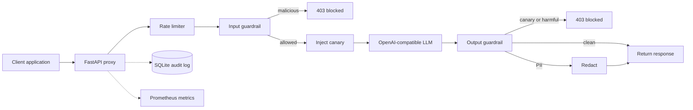

<div align="center">

# 🛡️ Aegis-ML

### An OpenAI-compatible firewall for LLM applications

Aegis classifies prompts before they reach a model, injects per-request canary
tokens, filters model output, and records every security decision.

[](https://github.com/hollowc2/Aegis-ML/actions/workflows/ci.yml)
[](https://huggingface.co/spaces/billybitcoin/aegis-ml)
[](https://www.python.org/)
[](LICENSE)

[Try the demo](https://huggingface.co/spaces/billybitcoin/aegis-ml) ·
[Read the threat model](docs/THREAT_MODEL.md) ·
[Review benchmarks](docs/BENCHMARKS.md)

</div>


## Why this project exists

An application cannot reliably defend against prompt injection by asking the
same model that is under attack to police itself. Aegis moves enforcement to a
separate service in front of the model:

```text
Client → rate limit → input classifier → canary injection → LLM
                                                     ↓
Client ← audit log ← output filtering ← canary check
```

Clients use the familiar `POST /v1/chat/completions` interface and change only
their base URL. A blocked input never reaches the backend model.

## Features

- **Drop-in proxy:** speaks `POST /v1/chat/completions`, so any OpenAI SDK,
  llama.cpp, vLLM, or Ollama setup works by changing the base URL.
- **Layered defenses:** ML input classification, per-request canary tokens to
  catch system-prompt leaks, PII redaction, and harmful-output filtering.
- **Fails closed:** classifier errors block the request; backend failures return
  `502` instead of passing through unchecked output.
- **Observable:** every allow/block decision goes to a SQLite audit log, with
  Prometheus metrics and per-IP rate limiting.
- **Pick your speed/accuracy trade-off:** a ~1.5 ms CPU baseline ships in the
  repo; DeBERTa classifiers and an sklearn → ONNX cascade are optional, with the
  full training, evaluation, and INT8 export pipeline included.
- **Easy to run:** locked dependencies, Docker, Compose, and a hosted demo.

## How is this different?

Other prompt-injection tools exist, and Aegis does not claim to beat them as a
classifier. The difference is where it sits and what it does around the
classifier:

- **[Llama Prompt Guard](https://huggingface.co/meta-llama/Llama-Prompt-Guard-2-86M)**
  is a classifier model. You still have to wire it into your app, decide what
  happens on a block, and log the result. Aegis is that wiring, as a service.
- **[LLM Guard](https://github.com/protectai/llm-guard)** offers a broader set
  of input/output scanners that you call from your application (the repository
  is now archived). Aegis has fewer scanners but is a transparent pass-through
  proxy, so the app needs no code changes.
- **[Rebuff](https://github.com/protectai/rebuff)** also layers detection with
  canary tokens, through an SDK inside your app (archived since 2024). Aegis
  does the canary check outside the app, next to the audit log, so a
  compromised or careless client can't skip it.

If you already use one of these, Aegis can still be the enforcement and logging
point in front of your model.

## See it in 30 seconds

Open the [live demo](https://huggingface.co/spaces/billybitcoin/aegis-ml), select
an attack example, and submit it. The analysis panel shows the classifier,
verdict, confidence, and latency. Benign responses are simulated in demo mode;
the full API mode forwards allowed requests to an OpenAI-compatible backend.

The demo lists only classifiers whose artifacts are loaded. If a model fails to
load, any heuristic fallback is explicitly labeled and must not be interpreted
as an ML model score.

## Architecture



Every input-classifier exception results in a block. Unknown backend failures
are returned as `502` errors rather than being treated as safe model output.
See [the threat model](docs/THREAT_MODEL.md) for trust boundaries and known
limitations.

## Classifier implementations

| Stage | Implementation | Purpose | Artifact availability |
|---|---|---|---|
| Phase 1 | TF-IDF + logistic regression | Lightweight baseline and fast path | Bundled |
| Phase 2 | DistilBERT or DeBERTa-v3-small | Semantic binary classification | Train/export separately |
| Phase 3 | Multi-task mDeBERTa-v3-base (multilingual) | Binary verdict plus 7 threat categories | Train/export separately |
| Cascade | sklearn → ONNX | Escalate ambiguous prompts (~24%) to a neural model | Requires ONNX artifact |

On the external benchmark — 7,435 prompts from five public datasets' test
splits, never trained or tuned on — at thresholds chosen on validation data
for ≤2% false positives:

| Model | Recall | FPR | ROC-AUC | Latency (p50) |
|---|---:|---:|---:|---:|
| Previous release (v1 sklearn, 0.70) | 70.5% | 6.3% | 0.928 | — |
| Phase 1 sklearn (bundled) | 91.9% | 1.8% | 0.985 | 1.4 ms (CPU) |
| Phase 3 mDeBERTa | 93.4% | 1.3% | 0.987 | 18 ms (GPU) |
| Phase 3 ONNX INT8 | 88.5% | 1.0% | 0.978 | 39 ms (CPU) |
| cascade2 (sklearn → mDeBERTa FP32) | 93.5% | 1.2% | 0.985 | — |
| cascade2 (sklearn → ONNX INT8, CPU) | 89.8% | 0.9% | 0.983 | 2.0 ms (p95 67 ms) |

Compared with the previous release, the bundled sklearn model catches about
21 more attacks per 100 and wrongly blocks roughly 3.5× fewer benign prompts.
The transformer adds a couple of points of recall and is much stronger on
multilingual and obfuscated attacks; the cascade keeps that accuracy while
sending only the ~24% of prompts sklearn is unsure about to it. INT8 shrinks
the ONNX graph from 1.1 GB to 323 MB at a cost of about 5 points of recall —
set `ONNX2_USE_INT8=false` when accuracy matters more than memory. Latency is
single-request on a Ryzen 7 1700 (4 threads) / RX 7700 XT.

The previous release's published 0.998 AUC came from a random split of a
dataset with heavy near-duplication; the rebuilt dataset is deduplicated,
length-balanced and split by near-duplicate family. Hand-written
out-of-distribution attacks (indirect injection, exfiltration, attacks buried
in long text) remain much harder — full methodology, per-category results and
caveats are in [docs/BENCHMARKS.md](docs/BENCHMARKS.md).

## Quick start

### Requirements

- Python 3.11 or 3.12
- [uv](https://docs.astral.sh/uv/)

```bash
git clone https://github.com/hollowc2/Aegis-ML.git
cd Aegis-ML
uv sync --locked
```

Run the local classifier demo:

```bash
uv run aegis-demo
# http://localhost:7860
```

Run the complete proxy:

```bash
cp .env.example .env
# Set BACKEND_URL in .env to your OpenAI-compatible model endpoint.
uv run aegis-serve
# http://localhost:8000
```

Test a benign request:

```bash
curl http://localhost:8000/v1/chat/completions \
  -H "Content-Type: application/json" \
  -d '{
    "model": "local-model",
    "messages": [{"role": "user", "content": "Explain TCP in one sentence."}]
  }'
```

## API surface

| Endpoint | Purpose |
|---|---|
| `POST /v1/chat/completions` | Guarded OpenAI-compatible chat completion |
| `GET /health` | Service and classifier readiness |
| `GET /metrics` | Prometheus metrics |
| `GET /audit/logs?limit=50` | Recent security decisions |

Example blocked response:

```json
{
  "error": {
    "message": "Request blocked by Aegis-ML guardrails.",
    "type": "guardrail_violation",
    "code": "prompt_injection_detected"
  }
}
```

## Configuration

Copy `.env.example` to `.env`. Common settings:

| Variable | Default | Description |
|---|---:|---|
| `BACKEND_URL` | `http://localhost:8080/v1/chat/completions` | Backend model endpoint |
| `CLASSIFIER_TYPE` | `sklearn` | `sklearn`, `hf`, `onnx`, `cascade`, `hf2`, `onnx2`, or `cascade2` |
| `CONFIDENCE_THRESHOLD` | model's tuned value | Block at or above this malicious probability; unset uses the threshold tuned for the loaded model |
| `RATE_LIMIT_PER_MINUTE` | `60` | Per-IP request limit |
| `REDACT_PROMPTS_IN_LOGS` | `false` | Exclude prompt text from audit records |
| `DATABASE_URL` | `sqlite+aiosqlite:///./logs/aegis_audit.db` | Audit database |

The template documents model paths, cascade thresholds, preprocessing controls,
and service settings.

## Training and evaluation

Train and evaluate the bundled baseline:

```bash
uv run python -m training.data.holdout_eval
uv run python -m training.data.prepare_dataset
uv run python -m training.phase1_sklearn.train --loso
uv run python -m training.eval_suite --model sklearn
```

Install the heavier transformer toolchain only when needed:

```bash
uv sync --locked --extra hf2
uv run aegis-train-hf2 --model mdeberta
uv run aegis-export-hf2 --validate
uv run python -m training.eval_suite --model cascade2
```

GPU training is optional; the bundled baseline and default demo run on CPU.

## Development

```bash
uv sync --locked --extra dev
uv run ruff check app demo tests
uv run pytest
uv run pytest --cov=app --cov=demo --cov-report=html
```

Adversarial model regression tests are opt-in because they require a selected
model artifact:

```bash
RUN_ADVERSARIAL_TESTS=1 CLASSIFIER_TYPE=sklearn uv run pytest \
  tests/test_adversarial_regression.py -v
```

CI runs linting, unit/integration tests, and coverage checks on Python 3.11.

## Docker

```bash
docker build -t aegis-ml .
docker run --rm -p 8000:8000 \
  -e BACKEND_URL=http://host.docker.internal:8080/v1/chat/completions \
  aegis-ml
```

Or start the proxy and demo together:

```bash
docker compose up --build
```

## Repository map

```text
app/                  FastAPI service, classifiers, guardrails, proxy, database
demo/                 Gradio demo
training/             Dataset, training, evaluation, and ONNX export pipelines
tests/                Unit, integration, preprocessing, and adversarial tests
notebooks/            Recorded baseline analysis and generated plots
docs/                 Benchmarks, threat model, and project documentation
models/               Bundled sklearn artifact; larger artifacts are ignored
```

## Limitations

Aegis reduces risk; it does not prove that an input or output is safe.
Classifiers can be evaded, regex redaction is incomplete, and the in-memory
canary store is intended for a single worker. Multi-process deployments require
a shared canary store, and the audit endpoint needs authentication before
exposure to untrusted networks. More detail is documented in
[docs/THREAT_MODEL.md](docs/THREAT_MODEL.md).

## License

Released under the [MIT License](LICENSE).
